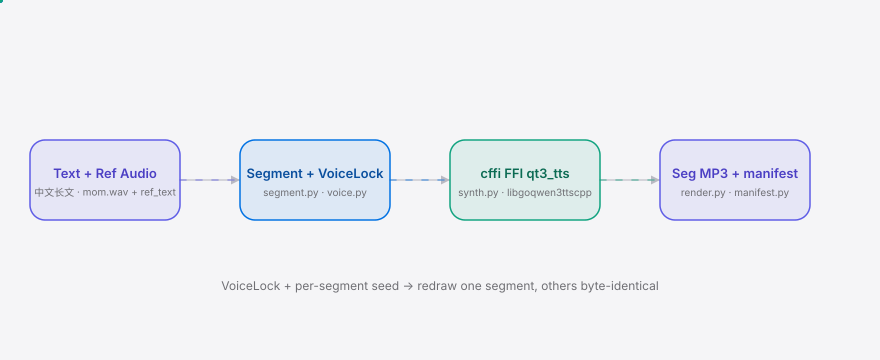

<div align="right"><sub><b>English</b>&nbsp;&nbsp;⇄&nbsp;&nbsp;<a href="./README.md">简体中文</a></sub></div>

<p align="center">
  <picture>
    <source media="(prefers-color-scheme: dark)" srcset="./assets/hero-dark.svg">
    <source media="(prefers-color-scheme: light)" srcset="./assets/hero-light.svg">
    
  </picture>
</p>

<p align="center"><sub>QwenVoice is the local CLI that reads long Chinese text in your own cloned voice — the voice biometric never leaves your machine.</sub></p>

<p align="center">
  <a href="./LICENSE"></a>
  <a href="https://github.com/SuperMarioYL/qwenvoice/releases"></a>
  <a href="https://github.com/SuperMarioYL/qwenvoice/actions/workflows/ci.yml"></a>
  
  
</p>

**Give it a 5-second clip of a family member's voice and it reads a whole Chinese essay aloud as segmented MP3 — redraw any single segment without changing the voice.**

<h2> Architecture</h2>

<p align="center">
  <picture>
    <source media="(prefers-color-scheme: dark)" srcset="./assets/atlas-dark.svg">
    <source media="(prefers-color-scheme: light)" srcset="./assets/atlas-light.svg">
    
  </picture>
</p>

Local GGUF inference for Qwen3-TTS is driven by the third-party [qwentts.cpp](https://github.com/ServeurpersoCom/qwentts.cpp) (packaged by LocalAI as the FFI shared library `libgoqwen3ttscpp`) — the first practical path that runs Chinese voice cloning offline on consumer hardware. QwenVoice wraps it in one command: lock the reference audio + its transcript + the talker/codec GGUF pair, synthesize in-process via cffi FFI (`qt3_load` + `qt3_tts`, no inference subprocess), and let ffmpeg turn the PCM into segmented MP3. The `VoiceLock` plus a per-segment fixed seed is what makes per-segment redraw leave the voice unchanged — a contract neither cloud TTS nor GPT-SoVITS offers.

## Why this exists

Cloud Chinese TTS (Azure, ByteDance Volcano) sounds great, but it requires uploading the voice sample — a biometric that Chinese users broadly refuse to hand over. Long-form text is billed per call, and every redraw changes the voice, so the same passage drifts across segments. ElevenLabs is weak on Chinese, has no offline path, and raises data-export compliance risk. After Qwen3-TTS landed on the llama.cpp / qwentts.cpp path in August 2026, "offline Chinese voice cloning" dropped from "needs a GPU + Python" to "consumer hardware + one command" for the first time. QwenVoice plugs that primitive into a "voice never leaves the machine + per-segment redraw of long Chinese text" layer — a domestic model running locally, with the reference audio staying on disk.

### How it compares

| Axis | QwenVoice | GPT-SoVITS (~40k stars) | Cloud TTS (Azure / Volcano) |
|---|---|---|---|
| Local offline inference | ✓ cffi FFI (qwentts.cpp) | ✓ Python + GPU | ✗ needs network |
| Voice sample uploaded | ✗ never | ✗ local | ✓ required |
| Runs on consumer hardware | ✓ GGUF Q8 | ✗ needs GPU | ✓ (cloud) |
| Per-segment redraw, voice locked | ✓ VoiceLock + fixed seed | partial (no in-place contract) | ✗ redraw changes voice |
| Long Chinese-text segmentation | ✓ jieba boundaries | partial | partial |
| Model maturity / voice naturalness | partial (Qwen3-TTS early) | ✓ more mature | ✓ best |

GPT-SoVITS still leads on model maturity and voice naturalness; QwenVoice differentiates on the "consumer hardware + per-segment redraw without voice drift" layer, not synthesis quality.

## Contents

- [Install](#install)
- [Quickstart](#quickstart)
- [Usage](#usage)
- [Demo](#demo)
- [Configuration](#configuration)
- [Pricing & commercial layer](#pricing--commercial-layer)
- [Roadmap](#roadmap)
- [License](#license)

<h2> Install</h2>

```bash
# Requires Python 3.12 + ffmpeg
uv tool install qwenvoice          # or: pipx install qwenvoice
```

The first run needs the Qwen3-TTS talker + codec GGUF pair (~1.7B quantized weights) and the qwentts.cpp FFI shared library:

```bash
scripts/fetch_model.sh             # download talker + codec GGUF to models/
qwenvoice init                     # probe GGUF / libgoqwen3ttscpp / ffmpeg, write ~/.qwenvoice/config.yml
```

<h2> Quickstart</h2>

Three commands from a cold clone to the first cloned-voice MP3 (synthesis time aside, each step < 60s):

```bash
qwenvoice init                                                      # 1. locate model + FFI lib
# record a 5–15s clip of a family member as mom.wav, note the transcript
qwenvoice say --voice mom.wav --ref-text "今天天气真好" \
  --text "Hello, welcome to QwenVoice." -o hello.mp3                # 2. read one line in that voice
open hello.mp3                                                      # 3. hear your family member say it
```

<details>
<summary>Sample output</summary>

```
$ qwenvoice init
artifact           status   path
talker GGUF        ok       models/qwen-talker-1.7b-base-Q8_0.gguf
codec/tokenizer    ok       models/qwen-tokenizer-12hz-Q8_0.gguf
qwentts.cpp FFI    ok       ./libgoqwen3ttscpp.dylib
ffmpeg             ok       ffmpeg
wrote /Users/you/.qwenvoice/config.yml

$ qwenvoice say --voice mom.wav --ref-text "今天天气真好" --text "Hello, welcome to QwenVoice." -o hello.mp3
locking voice...
voice lock: sha256:7c4a8d09ca...
synthesizing 1 segment (16 chars)...
synthesizing via qwentts.cpp FFI…
rendering MP3 → hello.mp3...
done → hello.mp3
ref_hash=sha256:7c4a8d09ca... seed=42
```
</details>

<h2> Usage</h2>

`qwenvoice` currently implements m1 (`say`, single-segment synthesis). `book` (m2 long-text) and `redraw` (m3 per-segment) are stubs — see the [roadmap](#roadmap).

```bash
# single-segment synthesis (m1, implemented): lock voice → FFI synth → MP3
qwenvoice say \
  --voice mom.wav \
  --ref-text "今天天气真好" \
  --text "Hello, welcome to QwenVoice." \
  -o hello.mp3

# pick a different fixed seed (same lock + same seed → same voice; the redraw contract)
qwenvoice say --voice mom.wav --ref-text "今天天气真好" --text "Second sentence." --seed 7 -o seg2.mp3

# override talker/codec GGUF or the FFI lib path (bypass config)
qwenvoice say --voice mom.wav --ref-text "..." --text "..." \
  --talker models/qwen-talker-1.7b-base-Q8_0.gguf \
  --codec  models/qwen-tokenizer-12hz-Q8_0.gguf \
  --ffi-lib ./libgoqwen3ttscpp.dylib -o out.mp3

# fall back to a local vLLM-Omni HTTP server (OpenAI-compatible /v1/audio/speech) when no FFI lib
qwenvoice say --voice mom.wav --ref-text "..." --text "..." \
  --http-fallback http://127.0.0.1:8000 -o out.mp3
```

The reference audio must be ≥ 5 seconds and you must supply its transcript (`--ref-text`) — Qwen3-TTS Base cloning needs both the reference audio and its transcript. If a ≥5s reference still cannot produce a recognizable cloned voice, the m1 kill-criterion gate triggers a halt.

<h2> Demo</h2>


10-minute happy path: `qwenvoice init` → record `mom.wav` → `qwenvoice say ... -o hello.mp3` → play. The terminal recording is in [`assets/demo.cast`](./assets/demo.cast); the vhs script is in [`docs/demo.tape`](./docs/demo.tape) (rendered to `assets/demo.gif` by `.github/workflows/demo.yml` on the first tag).

<h2> Configuration</h2>

`~/.qwenvoice/config.yml` (written by `qwenvoice init`, overridable via CLI flags):

| key | type | default | meaning |
|---|---|---|---|
| `talker_gguf` | str | `qwen-talker-1.7b-base-Q8_0.gguf` | path to the Qwen3-TTS talker GGUF |
| `codec_gguf` | str | `qwen-tokenizer-12hz-Q8_0.gguf` | 12 Hz codec/tokenizer GGUF (auto-discovered sibling `*tokenizer*.gguf`) |
| `ffi_lib_path` | str | `""` | `libgoqwen3ttscpp-*.so/.dylib` path; empty = auto-detect |
| `http_fallback_url` | str | `""` | local vLLM-Omni OpenAI-compatible `/v1/audio/speech` fallback URL |
| `ffmpeg_bin` | str | `ffmpeg` | ffmpeg binary path (wav→mp3 + concatenation) |
| `sample_rate` | int | `24000` | PCM sample rate (Qwen3-TTS = 24 kHz) |
| `channels` | int | `1` | channel count (mono) |
| `seed` | int | `42` | per-segment fixed seed (keeps redraws voice-locked) |
| `max_chars_per_segment` | int | `200` | soft ceiling for jieba segmentation (never cuts mid-sentence) |

<h2> Pricing & commercial layer</h2>

The paid layer is a **one-click desktop installer + family voice-pack manager GUI** for users who can't install Python / a cffi FFI library (runs locally — not cloud inference; the voice is always processed on-device):

| Tier | Form | Price | Notes |
|---|---|---|---|
| CLI + inference engine | open-source CLI (this repo) | free OSS (MIT) | full `say` / `book` / `redraw`, free forever |
| Desktop installer | one-time-purchase GUI | ¥39–69 / seat | one-click install + voice-pack manager + visual per-segment redraw, for non-technical users |
| Direct design-partner | WeChat DM | as needed | a whole-book cloned narration in exchange for a `NarrationManifest` sample + feedback |

Payments go through 爱发电 (one-time patron + license key) plus WeChat Pay / Alipay for direct DM; installer .dmg/.exe hosted on GitHub Releases (free). **No per-character billing, no hosted voice** — that would reintroduce the cloud model we're escaping. v0.1 ships only the CLI to hint at this layer; the GUI starts only after the Day-30 user validation passes (≥3/5 target users say they'd use it weekly).

<h2> Roadmap</h2>

- [x] **m1 voice lock + single-segment synthesis** — `qwenvoice say` runs offline: lock reference audio + transcript + talker/codec GGUF, produce a single cloned-voice MP3 via the qwentts.cpp FFI.
- [ ] **m2 long-text segmentation + audiobook** — `qwenvoice book`: jieba segmentation, per-segment offline synthesis, write `seg_001..NNN.mp3` + concatenated `full.mp3` + `manifest.json`.
- [ ] **m3 per-segment redraw** — `qwenvoice redraw`: redraw only the named segment, verify the others stay byte-identical and the voice is locked (the moat demo).
- [ ] Desktop installer GUI (paid layer, gated on Day-30 validation).

**Kill criteria** (falsifiable, not talk): (1) FFI path broken/abandoned >2 weeks and HTTP fallback also unavailable → halt; (2) m1 gate: a ≥5s reference still cannot clone a recognizable voice → core thesis is false, halt; (3) after 4 weekends + 3 launch events, installs <50 and <3/5 target users say they'd use it weekly → kill; (4) GPT-SoVITS ships a consumer-hardware GGUF one-click GUI first → kill or pivot within 2 quarters.

<h2> License</h2>

[MIT](./LICENSE) © 2026 SuperMarioYL. Issues and PRs welcome: [github.com/SuperMarioYL/qwenvoice/issues](https://github.com/SuperMarioYL/qwenvoice/issues).

<p align="center"><sub><a href="./LICENSE">MIT</a> © 2026 SuperMarioYL</sub></p>
