[English](./README.en.md) · [Website](https://qwenvoice.lei6393.com) · [GitHub](https://github.com/SuperMarioYL/qwenvoice)

<picture>
  <source media="(max-width: 600px) and (prefers-color-scheme: dark)" srcset="./assets/presentation/hero-mobile-dark.svg">
  <source media="(max-width: 600px)" srcset="./assets/presentation/hero-mobile-light.svg">
  <source media="(prefers-color-scheme: dark)" srcset="./assets/presentation/hero-dark.svg">
  
</picture>

# QwenVoice

**逐段准备中文配音**

QwenVoice 将参考音频记录、中文句子切分和单段语音命令连接起来。say 路径使用配置的 Qwen3-TTS 产物；book 将中文长文分段、逐段合成并拼接 full.mp3 + manifest.json，redraw 只重写目标段——语音输出需要可用的本地 Qwen3-TTS 运行时。

## 为什么需要它

配音流程需要明确每个输出对应的文本片段、参考录音和模型文件。QwenVoice 显式记录这些输入，本地切分器则让你在尝试合成前先检查中文句子边界。

- **检查分段边界** — 切分器按软字符上限聚合完整句子。
- **记录参考音频标识** — VoiceLock 对参考字节与转录文本计算哈希，并记录模型路径。
- **分开处理音频阶段** — 合成返回 PCM，渲染阶段转换音频并写入文件。

## 架构

<picture>
  <source media="(max-width: 600px) and (prefers-color-scheme: dark)" srcset="./assets/presentation/architecture-mobile-dark.svg">
  <source media="(max-width: 600px)" srcset="./assets/presentation/architecture-mobile-light.svg">
  <source media="(prefers-color-scheme: dark)" srcset="./assets/presentation/architecture-dark.svg">
  
</picture>

segment.py 提供单段与长文切分函数。VoiceLock 检查参考音频和模型路径，并为参考内容生成指纹。synth_segment 尝试 qt3_* FFI 接口，FFI 不可用时使用配置的 HTTP 语音端点。render.py 处理返回 PCM 和 MP3 输出。

| 组件 | 职责 |
| --- | --- |
| `Chinese text` | sentence-boundary segments |
| `VoiceLock` | reference and artifact paths |
| `Synth adapter` | FFI or HTTP speech |
| `Audio renderer` | PCM to MP3 |

## 安装与快速上手

文本演示需要 Python 3.12+ 和 uv。语音合成另需兼容 talker/codec GGUF 文件、FFI 库或配置端点、可用参考音频，以及用于 MP3 渲染的 FFmpeg。

```bash
git clone https://github.com/SuperMarioYL/qwenvoice.git
cd qwenvoice
uv venv --python 3.12
source .venv/bin/activate
uv pip install -e .
```

完整离线示例对给定中文文本运行 segment_long_text，并核对该样本的分段拼接可还原输入。不会生成音频。

```bash
.venv/bin/python examples/presentation_demo.py
```

## 实际运行示例

<picture>
  <source media="(max-width: 600px) and (prefers-color-scheme: dark)" srcset="./assets/presentation/process-mobile-dark.svg">
  <source media="(max-width: 600px)" srcset="./assets/presentation/process-mobile-light.svg">
  <source media="(prefers-color-scheme: dark)" srcset="./assets/presentation/process-dark.svg">
  
</picture>

The local segmenter returns three ordered segments and preserves this example’s text.

```text
{
  "input": "缓存保存可复用的结果。数据变化后需要失效。接下来，为每类数据选择有效期。",
  "soft_limit": 18,
  "segments": [
    {
      "id": 1,
      "text": "缓存保存可复用的结果。"
    },
    {
      "id": 2,
      "text": "数据变化后需要失效。"
    },
    {
      "id": 3,
      "text": "接下来，为每类数据选择有效期。"
    }
  ]
}
Input preserved: True
Scope: sentence-boundary text segmentation only; no voice cloning or audio synthesis.
```

完整命令与输出保存在 [docs/demo-results.json](./docs/demo-results.json). 输入和复现代码均随仓提供。

## 用法

运行音频命令前，应将产物和录音路径替换为真实兼容文件。init 报告可用性并写入 ~/.qwenvoice/config.yml；即使产物缺失也可能写配置。say 锁定输入并合成单段；book 分段、逐段合成并拼接完整有声书，redraw 依据 manifest.json 只重画目标段。请使用有权用于合成的参考音频。

```bash
.venv/bin/qwenvoice init --talker ./models/talker.gguf --codec ./models/codec.gguf --ffi-lib ./libgoqwen3ttscpp.dylib
.venv/bin/qwenvoice say --voice ./reference.wav --ref-text "参考录音的准确转录" --text "你好，欢迎收听。" --out ./hello.mp3
.venv/bin/qwenvoice book --voice ./reference.wav --ref-text "参考录音的准确转录" --file ./novel.txt --out ./book
.venv/bin/qwenvoice redraw ./book --seg 2 --text "改写后的第二句。"
```

## 配置

YAML 配置包含 talker_gguf、codec_gguf、ffi_lib_path、http_fallback_url、sample_rate、channels、seed 和 max_chars_per_segment。HTTP 基础地址通过 init --http-fallback http://127.0.0.1:8000 配置；say 没有 --http-fallback 参数。实现会追加 /v1/audio/speech，自 v0.2.0 起仅接受回环与私有（局域网/容器）地址，公网端点会被拒绝，参考资料永不离开本机。

## 集成与职责分工

<picture>
  <source media="(max-width: 600px) and (prefers-color-scheme: dark)" srcset="./assets/presentation/integrations-mobile-dark.svg">
  <source media="(max-width: 600px)" srcset="./assets/presentation/integrations-mobile-light.svg">
  <source media="(prefers-color-scheme: dark)" srcset="./assets/presentation/integrations-dark.svg">
  
</picture>

Python 包不包含模型权重或 FFI 库。参考哈希用于识别输入变化，不能保证音色相似度或音频确定性。语音端点需理解请求中的参考路径和转录字段。

| 路径 | 已实现职责 |
| --- | --- |
| Chinese text | local sentence splitter |
| Reference audio | recording plus transcript |
| GGUF artifacts | talker and codec paths |
| FFI / HTTP | configured synthesis adapters |
| FFmpeg / pydub | audio rendering helpers |

## 限制与后续方向

- book 与 redraw 的完整编排已实现：分段、逐段合成、拼接与 manifest 状态机；未触碰的段文件永不重写。语音输出需要兼容的 Qwen3-TTS 运行时（FFI 库或本地 HTTP 端点），其音质与合成确定性未在无运行时环境下验证。
- 单个长句可能超过软上限。当前切分器基于标点，并未使用 jieba 词边界。
- 本示例仅验证文本切分，未测试原生 ABI 兼容性、音色质量或音频输出。

已实现产物发现、参考指纹、单段与长文合成编排及文本音频辅助模块。后续是兼容运行时验证和具有实测音频一致性的局部重绘。当前示例不构成音色质量或重绘字节一致的承诺。

## 许可与贡献

许可见 [LICENSE](./LICENSE). 反馈问题时请提供最小输入、执行命令和实际输出。
